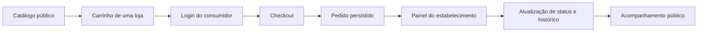

# Sextou Delivery

**Catálogo, checkout e operação de pedidos para delivery local.**

Aplicação Next.js que conecta a experiência do consumidor ao painel do estabelecimento e à administração da plataforma. O projeto inclui catálogo público, autenticação, cadastro de lojas e produtos, criação de pedidos e acompanhamento por código público.

[Funcionalidades](#funcionalidades) · [Fluxo do pedido](#fluxo-do-pedido) · [Executar](#executar-localmente) · [Arquitetura](#arquitetura) · [Verificação](#verificação) · [Limites](#limites-da-versão)

## Funcionalidades

| Perfil | O que pode fazer |
| --- | --- |
| Consumidor | Navegar por lojas ativas, montar carrinho de uma única loja, autenticar-se, informar a entrega e criar um pedido. |
| Estabelecimento | Gerenciar perfil e produtos; consultar seus pedidos e operar as transições permitidas de atendimento. |
| Administração | Consultar dashboard, categorias, clientes e estabelecimentos. |
| Visitante | Consultar catálogo público e acompanhar um pedido pelo código público. |

O catálogo considera a situação da loja e dos produtos. No checkout, o servidor recalcula os valores e cria pedido, itens, pagamento e histórico em transação. Mudanças de status do estabelecimento exigem o estado esperado, evitando atualizar silenciosamente uma versão desatualizada.

### Pagamentos: real e simulado são coisas diferentes

O fluxo M002 registra **pagamento manual em dinheiro na entrega**. Isso cria um registro operacional, não uma confirmação bancária.

O código também contém a etapa M004 para testar Pix/cartão e webhooks com o provedor **`fake-dev`**. A fábrica de pagamentos aceita esse provedor de desenvolvimento e rejeita outros nomes. Portanto, a existência de estados `PAID`, QR ou cenários de webhook em testes **não comprova uma integração real de pagamento**.

## Fluxo do pedido



O acompanhamento público usa `/pedido/[publicCode]`. Dados privados de entrega e identificadores internos pertencem às áreas autorizadas, não ao contrato público de tracking.

## Executar localmente

Prepare Node.js **20.19+**, npm, PostgreSQL de desenvolvimento e uma pasta gravável para uploads. Confira também a compatibilidade das dependências do lockfile com o runtime escolhido.

```bash
git clone https://github.com/dlr-1337/sextoudeliverypwa.git
cd sextoudeliverypwa
npm ci
cp .env.example .env
```

Configure no `.env`, fora do Git:

| Grupo | Configuração |
| --- | --- |
| Aplicação e banco | `NEXT_PUBLIC_APP_URL` e `DATABASE_URL` para um banco local descartável. |
| Sessão | `AUTH_SECRET` aleatório com pelo menos 32 caracteres, `SESSION_COOKIE_NAME` e `SESSION_MAX_AGE_DAYS`. |
| Administrador inicial | `SEED_ADMIN_NAME`, `SEED_ADMIN_EMAIL` e `SEED_ADMIN_PASSWORD`. |
| Uploads | `UPLOAD_DRIVER=local`, `UPLOAD_DIR`, `UPLOAD_PUBLIC_BASE_URL` e limite em bytes. |
| Pagamentos de teste | As variáveis `FAKE_PAYMENT_*` são exclusivas da configuração simulada; não preencha com chaves de um gateway real. |

Aplique as migrações versionadas e o seed:

```bash
npm run db:generate
npm run db:deploy
npm run db:seed
npm run dev
```

Acesse a URL configurada, normalmente **http://localhost:3000**. O seed cria ou atualiza o administrador e as categorias base; utilize somente dados de desenvolvimento. Para criar novas migrações durante desenvolvimento, use `npm run db:migrate` em vez de alterar o banco manualmente.

### Rotas para explorar

| Rota | Área |
| --- | --- |
| `/login` e `/cadastro` | Acesso e cadastro. |
| `/lojas` e `/lojas/[slug]` | Catálogo. |
| `/checkout` e `/conta` | Consumidor autenticado. |
| `/estabelecimento` | Gestão da loja. |
| `/estabelecimento/pedidos` | Pedidos do estabelecimento. |
| `/admin` | Administração. |
| `/pedido/[publicCode]` | Acompanhamento público. |

## Arquitetura

Next.js 16, React 19, TypeScript, PostgreSQL e Prisma compõem a base. Argon2 participa da autenticação, Zod da validação e `file-type` da identificação dos uploads. A implementação suporta armazenamento local de imagens PNG, JPEG e WebP; o limite é configurável.

- `src/modules/`: regras por domínio, incluindo autenticação, estabelecimentos, produtos, pedidos e pagamentos.
- `prisma/`: modelo, migrações e seed.
- `scripts/`: smokes e verificações integradas.
- `e2e/`: jornadas de navegador com Playwright.
- `docs/`: cobertura das entregas e contratos.

Consulte [package.json](package.json) para os scripts e [a fábrica de pagamentos](src/modules/payments/service.ts) para o limite do provedor disponível.

## Verificação

```bash
npm test
npm run lint
npm run build
```

Para jornadas integradas, prepare as variáveis e um **banco descartável**, instale o Chromium do Playwright e execute o gate desejado:

```bash
npx playwright install chromium
npm run verify:m001
npm run verify:m002
npm run verify:m003
# Somente com a configuração de pagamentos simulados preparada:
npm run verify:m004
```

Esses comandos criam registros de teste e encadeiam migrações, seed, smokes e, conforme a etapa, navegador. Não os aponte para produção. Os gates M001–M003 estão descritos nos relatórios de [M001](docs/m001-requirements-coverage.md), [M002](docs/m002-requirements-coverage.md) e [M003](docs/m003-requirements-coverage.md). O [smoke M004](scripts/verify-m004-payments-webhooks.ts) explicita os cenários simulados de pagamento.

## Diagnóstico rápido

Uma loja ausente do catálogo ou do painel deve ser conferida quanto a situação ativa e propriedade do registro. Uma atualização de status recusada exige recarregar o detalhe e verificar as transições permitidas, não contornar a validação. Falhas de seed, autenticação e upload devem ser investigadas pelos nomes das variáveis, sem imprimir segredos.

## Limites da versão

Gateway real de Pix/cartão, assinaturas do SaaS, armazenamento de objetos em produção, publicação final/PWA instalável e integrações externas não devem ser assumidos pelo nome do repositório. O projeto documenta um fluxo de desenvolvimento e verificação; preparação operacional e validação de uma implantação real são etapas separadas.
